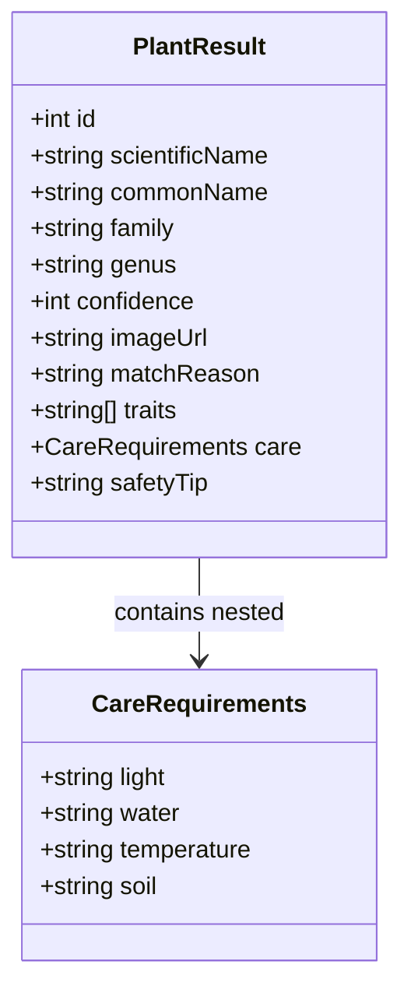
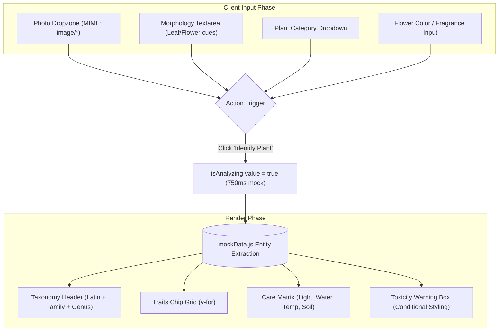

# AIPlantIdentifier Study: Vue 3 Architecture & Complex Data Modeling Guide

[](https://vuejs.org/)
[](https://vitejs.dev/)
[](LICENSE)
[](https://www.aiplantidentifier.net/)
[-green.svg?style=flat-square)](#)
[](#)

---

## 🌐 Original Platform Overview: What is AIPlantIdentifier?

The original production application [**AIPlantIdentifier**](https://www.aiplantidentifier.net/) is an AI-driven botanical identification and plant care advisory platform designed for home gardeners, indoor houseplant enthusiasts, and nature explorers.

### The Core Problem Solved
Caring for indoor houseplants and identifying wild flora can be notoriously difficult. Misidentifying a plant frequently leads to:
- Overwatering or underwatering due to conflicting care instructions.
- Exposing shade-loving foliage to scorching direct sunlight.
- Unknowingly introducing toxic ornamental plants to households with curious dogs and cats.

[aiplantidentifier.net](https://www.aiplantidentifier.net/) bridges this gap by combining computer vision with an extensive botanical knowledge base, converting a single leaf photo into a comprehensive horticultural care protocol.

### Original Features & Architecture
In production on [aiplantidentifier.net](https://www.aiplantidentifier.net/), the platform delivers:
1. **Botanical Taxonomy Engine**: Identifies over 30,000 plant species, providing binomial Latin nomenclature (Genus + Species), botanical Family classification, and regional vernacular names.
2. **Four-Pillar Care Dashboard**: Details tailored parameters for sunlight exposure, watering frequency, temperature tolerance, and soil composition.
3. **Pet Safety & Toxicity Alerts**: Highlights plants containing dangerous compounds (such as calcium oxalate raphides or saponins) to safeguard children and pets.
4. **Morphological Trait Tagging**: Categorizes plants by growth habit, drought resistance, air purification qualities, and humidity preferences.

---

## 🎯 Educational Edition Scope & Pedagogical Goals

This repository (`aiplantidentifier-study`) is an **isolated front-end learning environment** mirroring the user experience and dashboard structure of the AIPlantIdentifier homepage.

> **Important Student Notice**:  
> To provide a zero-maintenance sandbox for learning Vue 3, this study edition operates completely on client-side reactive mock datasets. There are **no external machine learning APIs, no cloud databases, and zero `.env` environment variables**.

### Key Learning Outcomes
- Modeling and rendering **deep hierarchical domain data** (nested care protocols and taxonomy).
- Safe template traversal using defensive optional chaining (`?.`).
- Implementing component-scoped ecological themes with CSS custom properties.

---

## 📸 Architectural Visualizations

### 1. Hierarchical Botanical Entity Model


### 2. Multi-Faceted Query & Rendering Pipeline


---

## 🔬 In-Depth Concept: Deep Nested Object Traversal and Safe Template Access

Real-world domain models are rarely flat. Modeling botanical data involves nested objects, arrays, and optional attributes. Handling these structures reliably in Vue 3 prevents runtime `TypeError: Cannot read properties of undefined` crashes.

### Structuring Nested Data in `mockData.js`
Notice how each plant entity in our mock store contains nested dictionaries for environmental care:

```javascript
export const MOCK_PLANT_RESULTS = [
  {
    id: 1,
    scientificName: "Monstera deliciosa",
    commonName: "Swiss Cheese Plant",
    family: "Araceae",
    genus: "Monstera",
    confidence: 98,
    care: {
      light: "Bright indirect light, avoid direct scorching sun",
      water: "Allow top 2-3 inches of soil to dry before soaking",
      temperature: "18°C ~ 28°C (Do not drop below 10°C in winter)",
      soil: "Loose peat-based potting soil mixed with perlite"
    },
    safetyTip: "Contains calcium oxalate crystals; mildly toxic to dogs and cats."
  }
];
```

### Safe Declarative Rendering in `PlantFinderCore.vue`
In Vue 3 single-file components, we render scalar attributes alongside nested dictionaries cleanly:

```html
<!-- Taxonomy Headers -->
<h4 class="plant-name">
  {{ item.commonName }}
  <span class="scientific-name"><i>{{ item.scientificName }}</i></span>
</h4>
<span class="taxonomy-info">{{ item.family }} · {{ item.genus }}</span>

<!-- Nested Care Matrix -->
<div class="care-guide-grid">
  <div class="care-item">
    <span class="care-icon">☀️ Light:</span>
    <span class="care-text">{{ item.care?.light }}</span>
  </div>
  <div class="care-item">
    <span class="care-icon">💧 Water:</span>
    <span class="care-text">{{ item.care?.water }}</span>
  </div>
  <div class="care-item">
    <span class="care-icon">🌡️ Temperature:</span>
    <span class="care-text">{{ item.care?.temperature }}</span>
  </div>
  <div class="care-item">
    <span class="care-icon">🪴 Soil:</span>
    <span class="care-text">{{ item.care?.soil }}</span>
  </div>
</div>
```

### Best Practices for Students
1. **Defensive Optional Chaining (`?.`)**: When data might be undefined during initial asynchronous fetches, writing `{{ item.care?.light }}` prevents template compilation crashes.
2. **Stable Unique Keys in Loops**: For tags and lists (`v-for="(trait, idx) in item.traits" :key="idx"`), providing a key ensures optimal Virtual DOM diffing.
3. **Thematic Encapsulation**: The ecological green color theme is declared globally in `style.css` via `:root { --primary: #16a34a; --background: #f0fdf4; }` and consumed modularly across components via `var(--primary)`.

---

## 📁 Source Code Directory Breakdown

```text
aiplantidentifier-study/
├── index.html                   # HTML entry point with leaf favicon
├── package.json                 # Scripts and minimal Vue 3 + Vite dependencies
├── vite.config.js               # Dev server configuration (Configured for Port 3003)
├── README.md                    # Technical documentation and learning curriculum
└── src/
    ├── main.js                  # Vue app initialization and mount logic
    ├── App.vue                  # Top-level composition assembling sections
    ├── style.css                # Green botanical theme tokens and CSS variables
    ├── data/
    │   └── mockData.js          # Static plant encyclopedia records and care guidelines
    └── components/
        ├── Navbar.vue           # Header navigation with nature branding
        ├── HeroSection.vue      # Hero banner introducing botanical identification
        ├── PlantFinderCore.vue  # Main interactive tool with dual mode and care grid
        ├── FeatureList.vue      # Card grid covering identification, care, and diagnostics
        ├── FaqSection.vue       # Interactive accordion for care and app usage FAQs
        └── FooterSection.vue    # Application footer with environmental theme
```

---

## 🛠️ Component Implementation Details

### 1. `PlantFinderCore.vue`
- **Dual Mode**: Supports image dropzone previews alongside descriptive text characteristics.
- **Taxonomy Header**: Highlights Latin botanical nomenclature in italics (`<i>{{ item.scientificName }}</i>`).
- **Care Grid**: Four-cell visual dashboard presenting essential light, water, temperature, and soil metrics.
- **Warning Callout**: High-visibility amber banner highlighting toxicity information.

### 2. `FeatureList.vue` & `FaqSection.vue`
- Features self-contained accordion and feature card components with scoped CSS styling.

---

## 🚀 Getting Started

### Prerequisites
- **Node.js**: `v18.0.0` or higher (Tested on `v23.11.0`)
- **Package Manager**: `npm` (v10+), `pnpm`, or `yarn`

### Installation & Local Development
```bash
# 1. Navigate to the project directory
cd aiplantidentifier-study

# 2. Install dependencies
npm install

# 3. Start the Vite development server
npm run dev
```

Visit the local development server:
```
http://localhost:3003
```

### Production Build
```bash
# Compile optimized static bundle
npm run build

# Preview production build locally
npm run preview
```

---

## 🎓 Recommended Exercises for Students

1. **Exercise 1: Add a Pet-Friendly Filter**:  
   Add a toggle in the filters row that filters out any plant where `safetyTip` indicates pet toxicity.
2. **Exercise 2: Care Difficulty Badge**:  
   Add a `difficulty` level ('Beginner', 'Intermediate', 'Expert') to each plant in `mockData.js` and render a colored indicator tag.
3. **Exercise 3: Search History Persistence**:  
   Save recently identified plant IDs in browser `localStorage` and display a "Recent Discoveries" chip carousel.
